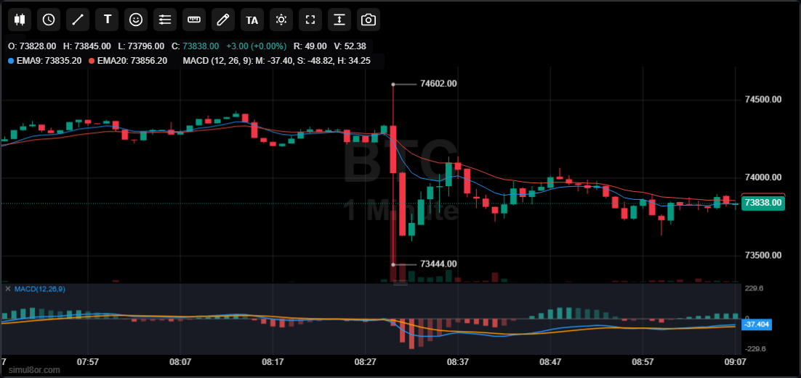
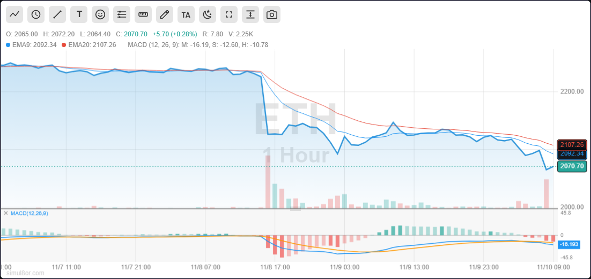

# JavaScript Stock Charts

**[View Live Demo on simul8or.com](https://simul8or.com/javascript-stock-chart.php)** - See the full capabilities in action with interactive examples and documentation.



A lightweight, zero-dependency JavaScript stock chart library for financial data visualization. Built on HTML5 Canvas with HiDPI support, technical indicators, candlestick pattern detection, and real-time interactivity.

## What's new in v4.1

- **Indicator picker** - The Indicators button opens a searchable list with categories and favorites
- **79 indicators** - 51 new, including Supertrend, Keltner and Donchian channels, pivot points, Hull/DEMA/TEMA/ALMA/McGinley averages, Chandelier exit, Williams Alligator and Fractals, Zig Zag, Aroon, Vortex, TSI, Klinger, Connors RSI and Fisher transform
- **Volume profile** - Visible range and session profiles with the point of control and value area
- **Legend controls** - One line per indicator; hover it to hide it, open its settings (inputs, colors, thickness) or remove it
- **Moving averages** - Add EMAs and SMAs as many times as you like, picking type, length and color in one step
- **New methods**: `setIndicatorEnabled`, `setIndicatorHidden`, `addMovingAverageInstance` (see [API Methods](#api-methods))

Upgrading from v4.0? Swap in the new `stock-chart.js`. The files and API are the same. v4.1.1 fixes the picker's search box picking up the host page's input styles.

## What's new in v4.0

- **New toolbar layout** - Chart settings sit in a top bar and the drawing tools in a strip down the left side
- **75+ drawing tools** - Trend lines and rays, Fibonacci and Gann, harmonic, head and shoulders and Elliott wave patterns, brushes and shapes
- **Long & short positions** - Risk/reward boxes that track the target and stop as price moves, plus anchored VWAP, volume profile and price/date ranges
- **Text, notes & emoji** - Labels and notes pinned to a price and time, a full emoji picker, scale and rotate
- **Drawing toolbar** - Select any drawing to change its color, fill, width and line style, or lock, clone or delete it
- **Magnet, box zoom and an eraser**, and a cursor menu with crosshair, dot and arrow modes
- **Sharp on every screen** - Candles, grid lines and indicator panes land on real device pixels
- **New options**: `toolbarLayout`, `emojiImages` and `logo` (see [Configuration Options](#configuration-options))

Upgrading from v3? The API is the same. Add `emoji-data.js` before `stock-chart.js`, and keep `s8-logo.svg` next to it. To keep v3's floating button row instead of the new top bar and tool strip, pass `toolbarLayout: 'overlay'`. Need an older version? Use the [`v3.0`](https://github.com/day-trading-simulator/javascript-stock-charts/tree/v3.0) or [`v2.0`](https://github.com/day-trading-simulator/javascript-stock-charts/tree/v2.0) tag.

## Features

### Core
- **Candlestick & Line Charts** - Toggle between chart types with a single click
- **HiDPI Rendering** - Crisp visuals on Retina and high-DPI displays
- **Dark/Light Mode** - Built-in theme switching
- **Responsive Design** - Adapts to any screen size, mobile-friendly with touch/pinch support
- **Volume Panel** - Toggleable volume bars below price data
- **Fullscreen Mode** - Expand charts with one click
- **Screenshot to Clipboard** - Copy chart as PNG with embedded branding

  

### Technical Indicators
79 indicators in a searchable picker. A sample:

- **Moving averages** - SMA, EMA (add as many as you like), WMA, Wilder's, Hull, DEMA, TEMA, ALMA, VWMA, McGinley, least squares
- **Trend** - Supertrend, Parabolic SAR, Ichimoku, ADX, Aroon, Vortex, Chandelier exit, Volatility stop, Williams Alligator and Fractals, Zig Zag
- **Oscillators** - RSI, MACD, Stochastic, Stochastic RSI, CCI, Williams %R, Awesome, TSI, Connors RSI, Fisher transform, Ultimate, Coppock
- **Volatility** - Bollinger Bands, %B and BandWidth, Keltner and Donchian channels, ATR, Historical volatility, Choppiness
- **Volume** - VWAP, OBV, Accumulation/distribution, Chaikin money flow, Klinger, Relative volume, visible range and session volume profile
- **Levels** - Pivot points, key levels (day high/low, premarket high/low, prior close)

Turn them on from code with the `indicators` option or `chart.setIndicatorEnabled(key, true)`. `StockChart.STUDIES` lists the keys, inputs and lines of the newer ones.

### Pattern Detection
Automatic candlestick pattern recognition via the included `patterns.js` module:

- Engulfing (bullish/bearish)
- Doji, Hammer, Shooting Star
- Morning/Evening Star
- And more

### Interactive Controls
- **Drag** - Pan horizontally and vertically
- **Mouse Wheel** - Zoom in/out
- **Pinch** - Zoom on touch devices
- **Hover** - Crosshair with real-time OHLC data
- **Price Scale Drag** - Adjust vertical scaling
- **Timeframe Selector** - Switch between 1min, 5min, 15min, 30min, 1hour, 4hour, daily, weekly
- **Drawing Tools** - 75+ tools in the left strip: lines, Fibonacci and Gann, patterns, forecasting, shapes, text, notes and emoji
- **AI Price Levels** - Overlay support/resistance levels programmatically

## Installation

Include the source files in your HTML. Keep `simul8or-logo.svg` and `s8-logo.svg` next to `stock-chart.js`.

```html
<link rel="stylesheet" href="stock-chart.css">
<script src="indicators.js"></script>
<script src="patterns.js"></script>
<script src="emoji-data.js"></script>
<script src="stock-chart.js"></script>
```

Or load it from the jsDelivr CDN. Pin a version so updates never change your chart unexpectedly:

```html
<link rel="stylesheet" href="https://cdn.jsdelivr.net/gh/day-trading-simulator/javascript-stock-charts@v4.1.1/stock-chart.css">
<script src="https://cdn.jsdelivr.net/gh/day-trading-simulator/javascript-stock-charts@v4.1.1/indicators.js"></script>
<script src="https://cdn.jsdelivr.net/gh/day-trading-simulator/javascript-stock-charts@v4.1.1/patterns.js"></script>
<script src="https://cdn.jsdelivr.net/gh/day-trading-simulator/javascript-stock-charts@v4.1.1/emoji-data.js"></script>
<script src="https://cdn.jsdelivr.net/gh/day-trading-simulator/javascript-stock-charts@v4.1.1/stock-chart.js"></script>
```

Screens 860px wide or less show the bare chart, without the top bar and tool strip.

## Quick Start

```html
<div id="chart-container" style="width: 100%; height: 500px;"></div>

<script>
  const data = [
    { t: 1675209600000, open: 180.68, high: 187.12, low: 179.26, close: 185.38, volume: 4235600 },
    { t: 1675296000000, open: 186.12, high: 194.32, low: 185.21, close: 188.74, volume: 5127800 },
    // ... more data points
  ];

  const chart = new StockChart('chart-container', {
    data: data,
    ticker: 'AAPL',
    darkMode: true,
    chartType: 'candlestick',
    timeframe: '1day'
  });
</script>
```

## Configuration Options

```javascript
const chart = new StockChart('container', {
  // Required
  data: ohlcData,           // Array of { t, open, high, low, close, volume }
  ticker: 'NVDA',           // Stock symbol (displayed as watermark)

  // Optional
  chartType: 'candlestick', // 'candlestick' or 'line'
  darkMode: false,          // Enable dark mode
  timeframe: '1day',        // '1min', '2min', '5min', '15min', '30min', '1hour', '4hour', '1day', '1week', '1month'
  toolbarLayout: 'side',    // 'side' (top bar + left tool strip, default) or 'overlay' (v3's floating buttons)
  padding: { top: 56 },     // Space above the price area for the legend (default 56)
  tickerLogoUrl: (symbol) => `https://your-cdn.example/logos/${symbol}.png`, // Logo next to the ticker (off unless set)
  emojiImages: 'https://your-cdn.example/twemoji/svg/', // Where emoji SVGs load from (default: Twemoji on jsDelivr); false = system emoji font
  logo: false,              // Hide the small s8 mark in the chart's corner

  // Indicators (enable/disable programmatically)
  indicators: {
    rsi: true,
    macd: false,
    bollinger: false,
    supertrend: true
  },

  // Moving averages
  movingAverages: [
    { type: 'sma', period: 20, enabled: true, color: '#2196F3' },
    { type: 'ema', period: 50, enabled: true, color: '#FF9800' }
  ]
});
```

## API Methods

```javascript
// Redraw the chart
chart.drawCharts();

// Destroy the chart and clean up
chart.destroy();

// Update configuration
chart.config.darkMode = true;
chart.drawCharts();

// Indicators
chart.setIndicatorEnabled('vrvp', true);            // visible range volume profile
chart.setIndicatorHidden('rsi', true);              // keep it on, stop drawing it
chart.addMovingAverageInstance('ema', 50, '#F5B14A');

// AI price level overlays
chart.addAIPriceLevel({ label: 'Entry', price: 185.50, color: '#00C851' });
chart.setAIPriceLevels([
  { label: 'Stop Loss', price: 178.00 },
  { label: 'Target', price: 195.00 }
]);
chart.clearAIPriceLevels();

// Handle container resize
window.addEventListener('resize', () => chart.resizeCanvases());
```

## Live Data

Feed new prices by updating the last candle (or pushing a new one) and redrawing. This example streams live BTC candles from Hyperliquid's free public API, with no key needed. `test.html` runs the full version.

```javascript
const toBar = c => ({ t: c.t, open: +c.o, high: +c.h, low: +c.l, close: +c.c, volume: +c.v });

// 1. Load the last 300 one-minute candles
const res = await fetch('https://api.hyperliquid.xyz/info', {
  method: 'POST',
  headers: { 'Content-Type': 'application/json' },
  body: JSON.stringify({ type: 'candleSnapshot', req: {
    coin: 'BTC', interval: '1m', startTime: Date.now() - 300 * 60000, endTime: Date.now() } })
});
const chart = new StockChart('chart-container', {
  data: (await res.json()).map(toBar),
  ticker: 'BTC', timeframe: '1min', chartType: 'candlestick', darkMode: true
});

// 2. Stream updates over a WebSocket
const ws = new WebSocket('wss://api.hyperliquid.xyz/ws');
ws.onopen = () => ws.send(JSON.stringify({ method: 'subscribe',
  subscription: { type: 'candle', coin: 'BTC', interval: '1m' } }));
ws.onmessage = e => {
  const msg = JSON.parse(e.data);
  if (msg.channel !== 'candle') return;
  const bar = toBar(msg.data), data = chart.stockData, last = data[data.length - 1];
  if (last && last.t === bar.t) Object.assign(last, bar);
  else {
    data.push(bar);
    if (chart.isViewPinnedToRightEdge)   // keep the newest candle in view
      chart.config.dataOffset = Math.max(0, data.length - chart.config.visibleCandles);
  }
  chart.calculateIndicators();
  chart.drawCharts();
};
```

## Browser Support

- Modern browsers with HTML5 Canvas support
- Chrome, Firefox, Safari, Edge
- Mobile browsers on iOS and Android

## Performance

- Canvas-based rendering (not SVG/DOM) for large datasets
- HiDPI-aware with devicePixelRatio scaling
- Debounced resize handling
- Optimized for both desktop and mobile

## Contributing

Contributions are welcome! Please feel free to submit a Pull Request.

## License

This project is licensed under the MIT License with an attribution requirement - the built-in branding link to simul8or.com must remain visible and functional. See the LICENSE file for details.

Emoji graphics are [Twemoji](https://github.com/jdecked/twemoji) by Twitter, Inc. and other contributors, licensed CC-BY 4.0.

---

Powered by [simul8or](https://simul8or.com)
